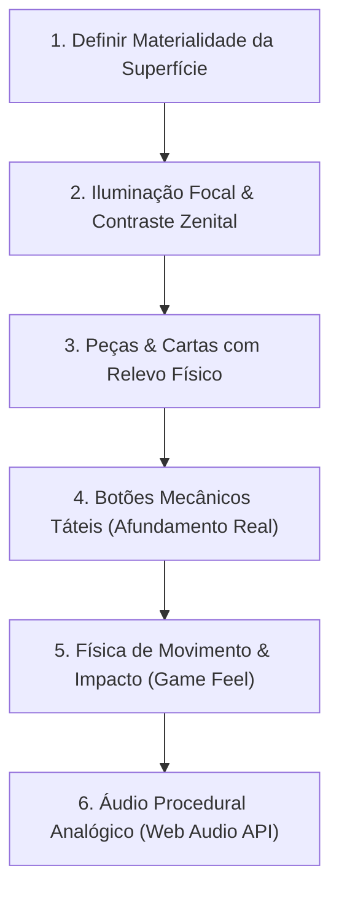

# Manual de Design Tátil & Anti-IA: Como Criar Interfaces Orgânicas, Vivas e Menos Sintéticas

Este guia consolida os princípios práticos, fórmulas CSS/JS e decisões de direção de arte aplicadas nas refatorações de alto nível da plataforma **Arkadice** (como *Nem a Pato*, *Golpe de Estado*, *Truco Goiano*, *Words on Stream*, *Última Letra* e *Flags*).

O objetivo é erradicar o visual genérico de "código gerado por IA" (*AI Slop*) e transformar qualquer jogo ou painel em uma experiência física, tátil e agradável.

---

## 1. O Que É o "Visual de IA" (AI Slop) e o Que Evitar

A maioria das IAs tende a produzir interfaces com o mesmo padrão mecânico, asséptico e sem gravidade:

| Sintoma de IA / Genérico | Por Que Parece Sintético? | O Que Fazer no Lugar (Abordagem Tátil) |
| :--- | :--- | :--- |
| **Gradientes Neon Roxo/Azul** | Efeito clichê de "cyberpunk/SaaS tech" (`#8b5cf6` para `#3b82f6`). | Paletas orgânicas de materiais reais: madeira mogno, feltro esmeralda, marfim, latão envelhecido, couro e papel linho. |
| **Cards Flutuantes Planos** | Bordas finas de 1px sem sombra de contato parecem "adesivos voando no vácuo". | Bordas chanfradas sólidas (3D Bevel), sombra de oclusão dupla (curta/escura + longa/suave) e textura sutil de linho/ruído. |
| **Emojis Crus do Sistema** | Emojis como 👑, 💰, 🃏, 🔥 soltos sem estilo quebram a coerência estética em cada OS. | Ícones vetoriais SVG estilizados (Lucide ou SVG sob medida) em medalhões/badges com relevo mecânico. |
| **Dark Mode Lavado (#0f172a)** | Fundo cinza/azulado estéril sem temperatura de luz. | Fundos com iluminação focal zenital (SpotLight / vinheta radial escura) que conduzem o olhar para a arena central. |
| **Botões sem Peso Mecânico** | Botões que apenas mudam opacidade no hover, sem afundar no clique. | Botões com chanfro 3D sólido na base (`box-shadow: 0 5px 0 #escuro`). No clique (`:active`), afundam fisicamente (`translateY(3px)`). |
| **Animações Lineares** | Elementos que deslizam friamente de um ponto a outro sem peso ou fricção. | Curvas elásticas (`power4.out`, `back.out(1.7)`), arcos parabólicos com elevação em Y e micro-tremores de impacto (`screen shake`). |
| **Silêncio ou Áudio em MP3 Externo** | Jogo mudo ou dependência de arquivos externos que falham no carregamento. | Áudio 100% procedural sintetizado na **Web Audio API** (estalos secos, ruído filtrado de feltro, boom subgrave e ressonância de madeira). |

---

## 2. Passo a Passo para Criar uma Interface Tátil



---

### Passo 1: Definir a Materialidade da Superfície (A "Mesa")

Não use um fundo escuro plano. Pense na superfície onde o jogo acontece como um objeto físico:
- **Truco**: Mesa de boteco com feltro verde esmeralda e borda de mogno envernizada.
- **Golpe de Estado**: Mesa de conselho secreto aristocrático com madeira entalhada e luz de vela quente.
- **Words on Stream / Termo**: Bandeja de marfim, baquelite ou madeira clara com nichos rebaixados.

#### Fórmula CSS de Superfície com Profundidade:
```css
/* Mesa com moldura de madeira nobre e feltro absorvente */
.game-table-wrap {
  position: relative;
  border-radius: 32px;
  background: linear-gradient(145deg, #180d07 0%, #0c0603 100%);
  box-shadow: 
    0 35px 90px rgba(0, 0, 0, 0.95),
    0 0 0 6px #120904,
    0 0 0 9px #854d0e,
    inset 0 2px 14px rgba(0, 0, 0, 0.85);
  overflow: hidden;
}

/* Feltro com vinheta focal central (luz zenital que ilumina o centro e escurece as bordas) */
.felt-surface {
  background: 
    radial-gradient(circle at 50% 40%, rgba(16, 185, 129, 0.18) 0%, transparent 70%),
    linear-gradient(180deg, #073f26 0%, #032013 100%);
}
```

---

### Passo 2: Cartas e Peças com Proporção Real e Luz Dinâmica

1. **Proporção Real**: Cartas de baralho devem ter `aspect-ratio: 5 / 7` (ex: `140px` por `196px`), e não retângulos arbitrários.
2. **Textura de Papel Plastificado**: Use um gradiente diagonal suave com ruído sutil.
3. **Interatividade 3D no Cursor (Mouse Tilt)**: A carta acompanha a inclinação do mouse com reflexo de luz móvel.

#### Código de Tilt 3D com Brilho Especular:
```javascript
function setupCard3DTilt(cardElement) {
  const sheen = document.createElement('div');
  sheen.className = 'card-specular-sheen';
  cardElement.appendChild(sheen);

  cardElement.addEventListener('pointermove', (e) => {
    const rect = cardElement.getBoundingClientRect();
    const x = e.clientX - rect.left;
    const y = e.clientY - rect.top;
    const px = (x / rect.width) * 100;
    const py = (y / rect.height) * 100;
    const rotY = ((x - rect.width / 2) / (rect.width / 2)) * 14;
    const rotX = -((y - rect.height / 2) / (rect.height / 2)) * 14;

    cardElement.style.transform = `perspective(800px) rotateX(${rotX.toFixed(1)}deg) rotateY(${rotY.toFixed(1)}deg) translateY(-24px) scale(1.08)`;
    sheen.style.opacity = '1';
    sheen.style.background = `radial-gradient(circle at ${px.toFixed(0)}% ${py.toFixed(0)}%, rgba(255, 255, 255, 0.45) 0%, rgba(255, 255, 255, 0) 65%)`;
  });

  cardElement.addEventListener('pointerleave', () => {
    cardElement.style.transform = '';
    sheen.style.opacity = '0';
  });
}
```

---

### Passo 3: Botões Físicos com Afundamento Mecânico

Abandone botões planos de biblioteca CSS. Crie botões com borda inferior sólida que descem e afundam no clique:

```css
/* Botão Tátil 3D */
.btn-tactile-primary {
  background: linear-gradient(135deg, #10b981, #047857);
  color: #fff;
  border: 1px solid #6ee7b7;
  border-radius: 12px;
  padding: 12px 24px;
  font-weight: 900;
  cursor: pointer;
  box-shadow: 
    0 5px 0 #064e3b,                      /* Chanfro inferior sólido */
    0 10px 20px rgba(16, 185, 129, 0.4); /* Sombra difusa projetada */
  transition: all 0.12s cubic-bezier(0.2, 0, 0, 1);
  display: inline-flex;
  align-items: center;
  gap: 8px;
}

.btn-tactile-primary:hover {
  transform: translateY(-2px);
  box-shadow: 
    0 7px 0 #064e3b,
    0 14px 26px rgba(16, 185, 129, 0.55);
}

.btn-tactile-primary:active {
  transform: translateY(4px);            /* Afunda exatamente a altura do chanfro */
  box-shadow: 
    0 1px 0 #064e3b,                     /* Chanfro quase sumindo */
    0 4px 8px rgba(16, 185, 129, 0.3);
}
```

---

### Passo 4: Game Feel e Impacto Físico (Pancadas, Carimbos e Tremores)

Quando algo importante acontece (jogar uma carta, submeter palavra, gritar Truco, acertar país):
1. **Arco Parabólico**: Não faça o objeto voar reto. Ele sobe em arco (`Math.sin(p * PI)`), cresce no ar (1.2x) e bate na mesa com desaceleração rápida (`power4.out`).
2. **Impacto de Carimbo (Stamp Impact)**: Banners de aposta ou alerta caem rapidamente e amortecem com elasticidade.
3. **Screen Shake (Micro-tremor)**: 80ms a 160ms de vibração sutil na tela no momento exato do impacto.

```css
/* Animação de Carimbo com Elasticidade */
@keyframes impactStamp {
  0% { transform: scale(2.2); opacity: 0; filter: blur(6px); }
  65% { transform: scale(0.94); opacity: 1; filter: blur(0); }
  85% { transform: scale(1.04); }
  100% { transform: scale(1.0); }
}

/* Micro-tremor de Câmera/Mesa */
@keyframes microShake {
  0%, 100% { transform: translate(0, 0); }
  20% { transform: translate(-3px, 2px); }
  40% { transform: translate(3px, -2px); }
  60% { transform: translate(-2px, -1px); }
  80% { transform: translate(2px, 1px); }
}

.trigger-shake {
  animation: microShake 0.16s cubic-bezier(0.36, 0.07, 0.19, 0.97) both;
}
```

---

### Passo 5: Áudio 100% Procedural com Web Audio API

Arquivos `.mp3` pesam a página, podem falhar se a rede oscilar e muitas vezes não têm o timing perfeito. A Web Audio API sintetiza o som no milissegundo exato, com zero bytes de download.

#### Arquitetura de um Som Físico Realista (Slap de Carta / Peça na Mesa):
Um som natural nunca é apenas um bipe senoidal. Ele é composto por **3 camadas simultâneas**:
1. **Transiente de Ataque (O estalo)**: Onda triangular em descida hiper-rápida (380Hz -> 75Hz em 45ms).
2. **Ruído de Fricção (O ar/papel batendo)**: Burst de ruído branco filtrado por filtro passa-faixa (Bandpass em 1400Hz).
3. **Ressonância do Corpo (A madeira/feltro)**: Onda senoidal grave abafada (125Hz -> 32Hz em 140ms).

```javascript
class ProceduralGameAudio {
  constructor() {
    this.ctx = null;
  }

  _init() {
    if (!this.ctx && typeof window !== 'undefined') {
      const AudioCtx = window.AudioContext || window.webkitAudioContext;
      if (AudioCtx) this.ctx = new AudioCtx();
    }
    if (this.ctx && this.ctx.state === 'suspended') {
      this.ctx.resume();
    }
  }

  // Estalo seco de carta / peça na mesa
  playImpactSlap() {
    this._init();
    if (!this.ctx) return;
    const t = this.ctx.currentTime;

    // 1. Transiente inicial
    const snap = this.ctx.createOscillator();
    const snapGain = this.ctx.createGain();
    snap.type = 'triangle';
    snap.frequency.setValueAtTime(380, t);
    snap.frequency.exponentialRampToValueAtTime(70, t + 0.04);
    snapGain.gain.setValueAtTime(0.4, t);
    snapGain.gain.exponentialRampToValueAtTime(0.001, t + 0.05);
    snap.connect(snapGain);
    snapGain.connect(this.ctx.destination);
    snap.start(t);
    snap.stop(t + 0.05);

    // 2. Ruído filtrado
    const bufSize = Math.floor(this.ctx.sampleRate * 0.04);
    const buf = this.ctx.createBuffer(1, bufSize, this.ctx.sampleRate);
    const data = buf.getChannelData(0);
    for (let i = 0; i < bufSize; i++) data[i] = (Math.random() * 2 - 1);
    const noise = this.ctx.createBufferSource();
    noise.buffer = buf;
    const filter = this.ctx.createBiquadFilter();
    filter.type = 'bandpass';
    filter.frequency.setValueAtTime(1400, t);
    const noiseGain = this.ctx.createGain();
    noiseGain.gain.setValueAtTime(0.25, t);
    noiseGain.gain.exponentialRampToValueAtTime(0.001, t + 0.04);
    noise.connect(filter);
    filter.connect(noiseGain);
    noiseGain.connect(this.ctx.destination);
    noise.start(t);

    // 3. Batida oca da mesa
    const thud = this.ctx.createOscillator();
    const thudGain = this.ctx.createGain();
    thud.type = 'sine';
    thud.frequency.setValueAtTime(120, t);
    thudGain.gain.setValueAtTime(0.45, t);
    thudGain.gain.exponentialRampToValueAtTime(0.001, t + 0.15);
    thud.connect(thudGain);
    thudGain.connect(this.ctx.destination);
    thud.start(t);
    thud.stop(t + 0.16);
  }
}
```

---

## 3. Checklist Rápido de Qualidade Visual

Antes de finalizar qualquer entrega de jogo ou interface, passe por este checklist:

- [ ] **A mesa tem identidade física?** (Madeira, feltro, metal, pedra ou papel linho, e não um fundo cinza uniforme).
- [ ] **A iluminação é focal?** (Existe uma vinheta ou foco zenital suave que guia o olho para onde a ação acontece).
- [ ] **Zero emojis soltos do sistema?** (Substituídos por ícones SVG bem diagramados ou medalhões ilustrados).
- [ ] **Os botões afundam no clique?** (Presença de chanfro 3D inferior com `transform: translateY` no `:active`).
- [ ] **As cartas/peças reagem ao cursor?** (Tilt 3D sutil com brilho especular dinâmico no hover).
- [ ] **Os impactos têm peso físico?** (Micro-tremor de tela de 80ms e som seco ao colidir).
- [ ] **O áudio é 100% procedural?** (Sem requisições de áudio externo quebradas, usando osciladores e ruídos sintetizados na Web Audio API).
- [ ] **O placar parece um objeto?** (Placa de latão, madeira ou entalhe físico com pulso animado quando a pontuação muda).
